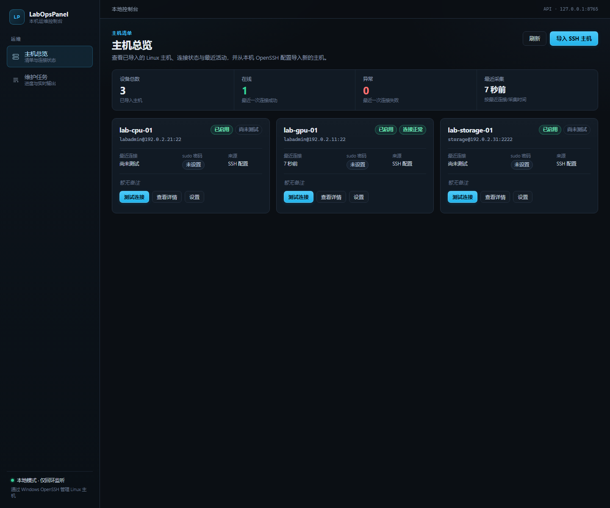
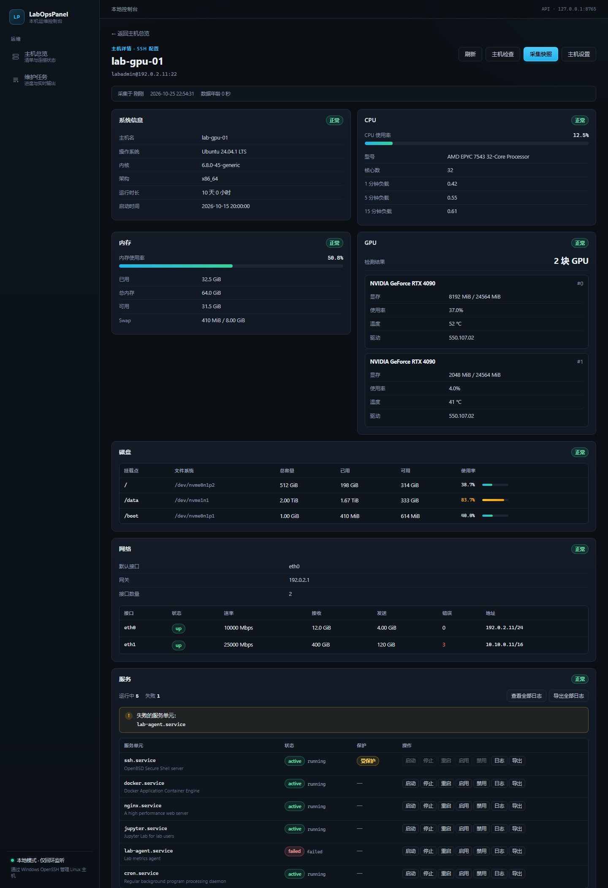
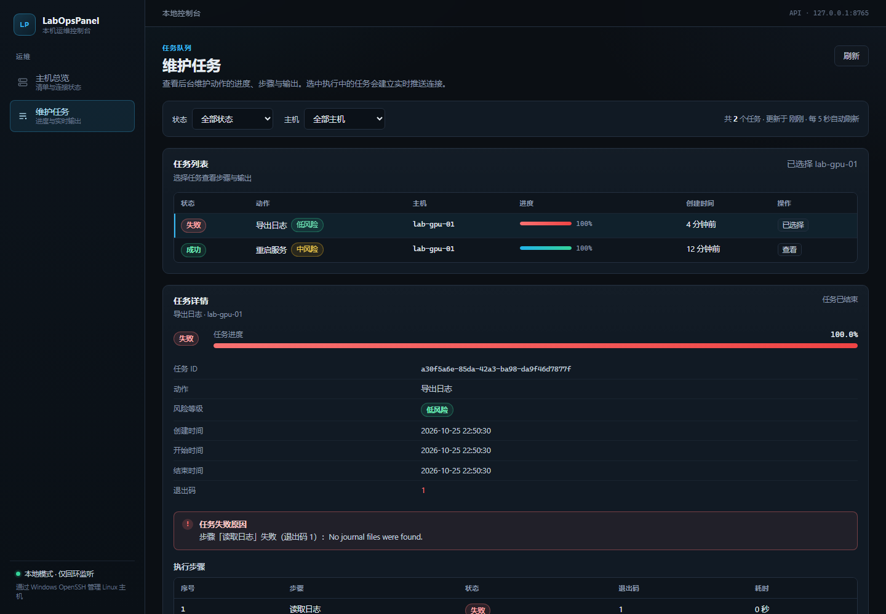
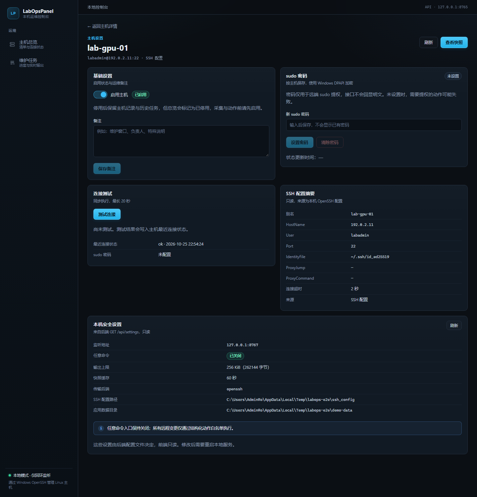

# LabOpsPanel

Windows 本机运行、通过 SSH 管理 Linux 主机的 Web 控制台。浏览器打开本地页面即可查看多台服务器状态、读取日志、启停 systemd 服务，无需在远端安装常驻 Agent。

- 后端：Python 3.12 + FastAPI + SQLAlchemy + Alembic + SQLite，SSH 复用 Windows OpenSSH 客户端。
- 前端：React + TypeScript + Vite，REST 拉取快照、SSE 订阅长任务进度。
- 凭据：每台主机的 sudo 密码使用 Windows DPAPI 加密后存库，明文只存在于内存与本机用户的 DPAPI 解密结果中。

## 快速开始

```powershell
# 1. 安装后端依赖（含开发依赖）
uv sync --extra dev

# 2. 构建前端
cd frontend
npm install
npm run build
cd ..

# 3. 启动（默认 http://127.0.0.1:8765）
uv run labopspanel
```

开发模式下可分别启动后端与 Vite 开发服务器（前端固定监听 `127.0.0.1:55173`，Vite 会把 `/api` 代理到 `127.0.0.1:8765`）：

```powershell
uv run uvicorn lab_ops_panel.app:create_app --factory --reload --port 8765
cd frontend; npm run dev
```

首次使用：在「主机总览」点击「导入 SSH 主机」，选择 `%USERPROFILE%\.ssh\config` 中的 Host；为需要提权操作的主机在「主机设置」保存 sudo 密码；随后即可采集状态与执行维护动作。

服务启动后访问 <http://127.0.0.1:8765>，OpenAPI 文档位于 <http://127.0.0.1:8765/api/docs>。

如果 8765 已被其他本机程序占用，可换端口启动：`uv run labopspanel --port 8766`；此时请把
`frontend/vite.config.ts` 中的代理目标同步改为该端口（仅影响 `npm run dev`，生产构建由后端同源托管）。前端开发地址固定为 `http://localhost:55173`；若该端口被占用，Vite 会直接报错而不会自动换端口。

## 界面预览

| 主机总览 | 主机详情 |
| --- | --- |
|  |  |

| 维护任务 | 主机设置 |
| --- | --- |
|  |  |

采集失败时按分区展示原因，GPU 缺失显示 `N/A`（见 [错误态截图](docs/screenshots/05-host-detail-error.png)）。

## 常用命令

| 命令 | 说明 |
| --- | --- |
| `uv sync --extra dev` | 安装/更新 Python 依赖 |
| `uv run pytest` | 后端测试 |
| `uv run ruff check .` | Python Lint |
| `uv run ruff format --check .` | Python 格式校验 |
| `uv run labopspanel` | 启动本地服务（默认 127.0.0.1:8765） |
| `uv run alembic upgrade head` | 手动执行数据库迁移（服务启动时也会自动执行） |
| `cd frontend; npm ci` | 安装前端依赖 |
| `cd frontend; npm run dev` | Vite 开发服务器 |
| `cd frontend; npm run typecheck` | TypeScript 类型检查 |
| `cd frontend; npm test` | 前端单元测试 |
| `cd frontend; npm run build` | 生产构建（`frontend/dist`） |

## 配置

环境变量前缀 `LABOPS_`：

| 变量 | 默认值 | 说明 |
| --- | --- | --- |
| `LABOPS_APP_DATA_DIR` | `%LOCALAPPDATA%\LabOpsPanel` | SQLite 数据库所在目录 |
| `LABOPS_SSH_CONFIG_PATH` | `%USERPROFILE%\.ssh\config` | SSH 配置路径 |
| `LABOPS_BIND_HOST` / `LABOPS_BIND_PORT` | `127.0.0.1` / `8765` | 监听地址与端口；非回环地址需同时设置 `LABOPS_ALLOW_REMOTE_BIND=true` |
| `LABOPS_SNAPSHOT_TTL_SECONDS` | `20` | 快照缓存有效期 |
| `LABOPS_MAX_OUTPUT_BYTES` | `262144` | 单流输出上限 |
| `LABOPS_ALLOW_ARBITRARY_COMMANDS` | `false` | 是否开启任意命令入口（仍经语法检查与确认） |
| `LABOPS_MAX_CONCURRENT_TASKS` | `3` | 后台任务并发数 |
| `LABOPS_SECRET_BACKEND` | 空 | 设为 `disabled` 可禁用 DPAPI（仅用于排障） |

## 安全边界

- 只监听回环地址，本机免登录、单管理员模式；不提供多用户 RBAC。
- 运行时数据（数据库、日志）写在用户目录，不进入源码树。
- 远程写操作只允许固定动作白名单，全部带参数校验、预检、二次确认、超时、输出上限与幂等键。
- SSH、网络与 systemd 关键服务受保护：禁止从本应用执行 `stop` / `disable`。
- 日志只记录动作、目标、时间、状态与错误摘要，不记录密码与完整输出。

## 目录结构

```text
src/lab_ops_panel/      后端：API、SSH 传输、探针、动作、任务、凭据、迁移
frontend/               React + TypeScript 前端
tests/                  后端测试（临时数据库与假传输，不接触真实主机）
docs/requirements/      需求、架构、验收与 API 契约
```

## 文档

- [需求与边界](docs/requirements/README.md)
- [架构与实现要求](docs/requirements/architecture.md)
- [验收标准与实施状态](docs/requirements/acceptance.md)
- [API 契约](docs/requirements/api.md)
- [安全设计与残余风险](docs/requirements/security.md)

## 已知限制

- 只导入 OpenSSH 配置中的显式 `Host`；通配 `Host` 块仅作为默认值来源，`Match` 块不参与解析。
- 首版为单管理员、免登录模式，只允许绑定回环地址。
- 任意命令入口默认关闭；开启前请先确认目标主机与影响范围。
- 首版不包含多用户、批量变更、磁盘格式化、GPU 进程视图与 SSH 公钥管理。
- 本目录尚未初始化 Git 仓库；如需版本管理，可执行 `git init` 后再提交。
